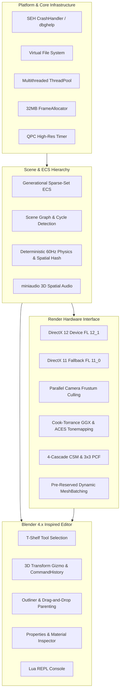

# RLengine 7.1 Architecture and Technical Specifications

This document provides an in-depth, verified technical overview of the architecture, subsystems, and internal design of **RLengine 7.1** (C++23 / DirectX 12 & DirectX 11 / Lua 5.4 / Generational Sparse-Set ECS / Blender-style DCC Editor).

---

## 1. Engine Mission and Architecture Principles

**RLengine 7.1** is a high-performance real-time 3D engine engineered to modern **C++23** standards with an emphasis on performance, hardware reliability, verified implementations, and pre-reserved batching.

### Core Architectural Guarantees:
* **Verified Capabilities Only**: All documented features correspond directly to executed code in the engine. Exaggerated marketing claims are replaced with accurate technical specifications.
* **DirectX 12 First with Solid DX11 Fallback**: The primary rendering backend targets `D3D_FEATURE_LEVEL_12_1` using DXC Shader Model 6.5 (`vs_6_5`, `ps_6_5`). A dedicated Direct3D 11 fallback pipeline targets `D3D_FEATURE_LEVEL_11_0` using D3DCompile Shader Model 5.0.
* **Pre-Reserved Batching**: Hot-path frame rendering uses pre-reserved member batching arrays and a 32 MB linear `FrameAllocator` to minimize heap overhead.
* **Hardware Resilience**: Complete Windows SEH minidump capture via `dbghelp.dll`, robust resource barrier tracking, and graceful fallback paths.

---

## 2. Technology Stack Overview

* **Programming Language**: C++23 (MSVC `/std:c++23`, `/permissive-`, `/utf-8`, `/Zc:__cplusplus`, `/fp:fast`, builds clean under `/W4` with 8 warnings disabled for third-party headers and conversions).
* **Graphics Backends**:
  * **DirectX 12 Backend**: Target feature level `D3D_FEATURE_LEVEL_12_1`, DXGI 1.6 swapchain with `DXGI_SWAP_EFFECT_FLIP_DISCARD`, triple buffering (`NUM_FRAMES = 3`), hardware Variable Refresh Rate (Tearing) detection, root signatures with descriptor tables and 32-bit push constants.
  * **DirectX 11 Backend**: Direct3D 11.0 hardware fallback (`D3D_FEATURE_LEVEL_11_0`), immediate context execution, diffuse lighting, ground grid, hierarchical transforms. Automatically selected when DX12 fails or via `--dx11`.
* **Shader Compilation**:
  * **DXC API (`dxcompiler.dll` + `dxil.dll`)**: Compiles modern HLSL targeting Shader Model 6.5 (`vs_6_5`, `ps_6_5`).
  * **D3DCompile API (`d3dcompiler_47.dll`)**: Compiles legacy HLSL targeting Shader Model 5.0 (`vs_5_0`, `ps_5_0`).
* **Entity Component System**: Generational Sparse-Set ECS tested at 100,000 active entities (dynamic instance buffer starting at 16,384 instances and doubling on demand) with $O(1)$ component operations, dense memory iteration, and scene graph parent-child transforms.
* **Physics Engine**: Deterministic fixed-step 60Hz solver with sub-stepping (`kSubSteps = 2`), spatial hash broadphase grid, momentum-conserving impulse resolution, restitution, ground collision, and slab AABB ray-box / ray-sphere intersection testing.
* **Audio Engine**: 3D spatial positional audio powered by the `miniaudio` library.
* **Scripting**: Embedded Lua 5.4 VM with native C++ bindings for entities, camera, input, and logging.
* **DCC Editor**: Modular fixed-layout editor workspace modeled after Blender 4.x standards via Dear ImGui (v1.90.4).
* **Reliability**: Windows Structured Exception Handling (SEH) unhandled exception filter generating full timestamped crash minidumps via `MiniDumpWriteDump`.

---

## 3. Subsystem Architecture



---

### 3.1 DirectX 12 Modern PBR Renderer

The primary renderer is an instanced, physically-based forward rendering pipeline designed for modern hardware:

* **Cook-Torrance GGX Microfacet BRDF**:
  * **Normal Distribution Function (NDF)**: Trowbridge-Reitz GGX:
    $$D_{GGX}(N, H, \alpha) = \frac{\alpha^2}{\pi ((N \cdot H)^2 (\alpha^2 - 1) + 1)^2}$$
  * **Geometry Shadowing/Masking**: Smith Joint GGX formulation with Schlick-GGX approximation:
    $$G(N, V, L, k) = \frac{N \cdot V}{(N \cdot V)(1 - k) + k} \cdot \frac{N \cdot L}{(N \cdot L)(1 - k) + k}$$
  * **Fresnel Reflectance**: Fresnel-Schlick approximation with metallic interpolation:
    $$F(V, H) = F_0 + (1 - F_0)(1 - (V \cdot H))^5, \quad F_0 = \text{lerp}(0.04, \text{Albedo}, \text{Metallic})$$
* **ACES Filmic Tone Mapping**: Industry-standard Academy Color Encoding System fitted curve for wide-gamut filmic contrast and sRGB gamma correction ($\gamma = 2.2$).
* **4-Cascade Shadow Mapping (CSM)**:
  * 4 view-frustum depth cascades rendered into 2048x2048 shadow depth textures.
  * Sub-texel camera snapping in light-space coordinates to eliminate shadow edge shimmering during camera movement.
  * Normal-offset bias to prevent shadow acne without surface detachment.
  * 3x3 Percentage Closer Filtering (PCF) for soft, anti-aliased shadow penumbrae.
* **Point Light Shadows**: 1024x1024 perspective depth pass with distance attenuation and 3x3 PCF filtering.
* **High-Throughput Dynamic GPU Instancing**:
  * Unified StructuredBuffer storing per-instance world matrices, normal matrices, albedo colors, material parameters, and texture indices.
  * Dynamically grows from 16,384 instances (~2.3 MB per frame) with geometric power-of-two doubling on demand; tested at 100,000 entities (~40 FPS on RTX 5060, 1600x900).
* **Frustum Culling & Pre-Reserved Batching**:
  * Fast extraction of 6 normalized frustum planes (Left, Right, Bottom, Top, Near, Far) from the View-Projection matrix.
  * Bounding sphere intersection tests (`FrustumPlanes::TestSphere`) skipping off-screen instances for both 3D meshes and 2D quads prior to GPU dispatch.
  * Persistent vectors (`m_activeBatches`, `m_visibleMeshIndices`, and `m_visibleQuadIndices`) pre-reserved at initialization.
  * Drawing performed strictly via `m_activeBatches` using `cmdList->DrawIndexedInstanced(mesh->GetIndexCount(), batch.Count, 0, 0, batch.StartInstance)`, using persistent pre-allocated buffers throughout the render pass.

---

### 3.2 DirectX 11 Fallback Pipeline

For systems without full DirectX 12 support or legacy environments:
* Targets `D3D_FEATURE_LEVEL_11_0` via Direct3D 11.0 / 11.1 runtime.
* Shader compilation using `d3dcompiler_47.dll` targeting Shader Model 5.0 (`vs_5_0`, `ps_5_0`).
* Standalone rendering pipeline supporting diffuse directional lighting, ambient shading, ground grid, and hierarchical entity transforms.
* Invoked automatically when DX12 device creation fails or explicitly via the `--dx11` command-line switch.

---

### 3.3 Generational Sparse-Set ECS with Scene Graph

The engine's data core is a fast, cache-friendly entity component system:
* **Generational Entity Handles**: Each `Entity` is a 64-bit value packed into a 32-bit index and a 32-bit generation version. Dead entity recycling guarantees zero dangling handle bugs.
* **Sparse-Set Component Pools**: Component pools maintain a dense array of component data alongside sparse index lookups. Entity iteration occurs contiguously in memory for optimal CPU cache line utilization.
* **Scene Graph Hierarchy**:
  * `RelationshipComponent` storing parent handle and dynamic children array.
  * `Scene::SetParent` includes complete cycle detection via `Scene::IsAncestor`, walking up the ancestor chain to prevent cyclic dependencies.
  * `Scene::GetWorldMatrix` iteratively composes local matrices up the hierarchy with a recursion depth guard (`depth < 64`) to derive accurate world-space transforms without risk of stack overflow.

---

### 3.4 3D Physics Engine (`PhysicsSystem`)

A deterministic, fixed-time-step physics engine:
* **Fixed 60Hz Step with Sub-Stepping**: Accumulator-based fixed time step ($1/60$s) with two sub-steps ($kSubSteps = 2$) for integration stability.
* **Spatial Hash Broadphase**: 3D spatial grid hashing entity positions into cell buckets ($4.0\text{m}$ cell size), reducing pairwise collision checks from $O(N^2)$ to $O(N)$.
* **Collision Resolution**: Momentum-conserving impulse resolution with restitution, frictional damping, and ground plane ($Y=0$) support.
* **Raycasting**: High-precision slab AABB ray-box (with scaled collider offset and half-sizes) and ray-sphere intersection testing returning hit entity, world hit position, hit surface normal, and distance.
* **Simulation Snapshot & Restore**: Non-destructive snapshotting (`CaptureSnapshot` / `RestoreSnapshot`) allowing the editor to run real-time physics simulations and revert entity positions when leaving play mode.

---

### 3.5 3D Spatial Audio Subsystem

* Audio playback powered by `miniaudio`.
* 3D positional audio calculation based on camera listener position and audio emitter entities.
* Clean initialization, multithreaded stream decoding, and leak-free shutdown.

---

### 3.6 Blender 4.x Inspired Editor Suite

Built on Dear ImGui with custom styling matching Blender 4.x:
* **Left Tool Shelf (T-Panel)**: Tool switcher supporting Select Box, 3D Cursor, Move (`G`), Rotate (`R`), Scale (`S`), Transform, and Add Mesh.
* **3D Viewport & Navigation Compass**: Interactive 3D XYZ orientation compass widget with color-coded axes (+X Red, +Y Green, +Z Blue) and clickable view snapping (Front, Top, Right, Ortho/Persp).
* **Interactive Transform Gizmos**: Screen-space translation, rotation, and scale manipulators with real-time axis snapping.
* **Undo/Redo Command History**: `CommandHistory` ring buffer supporting `Ctrl+Z` undo and `Ctrl+Y` redo for all transform modifications and entity adjustments.
* **Outliner Panel**: Virtualized tree view powered by `ImGuiListClipper` (maintaining 57+ FPS under 100k+ entities) organizing scene collections and entities, featuring drag-and-drop parenting, visibility (Eye) and render (Camera) toggles.
* **Properties Inspector**: Detailed inspector for transforms (RGB Location/Rotation/Scale badges), mesh parameters, light intensity, and Principled BSDF material settings.
* **In-Game Lua REPL Console**: Interactive console (`~` or `F1`) for live Lua scripting, command evaluation, and log inspection.

---

### 3.7 Platform, Memory & Reliability Subsystem

* **SEH CrashHandler**: Windows Structured Exception Handling filter capturing fatal crashes and writing timestamped minidump files (`logs/crash_YYYYMMDD_HHMMSS.dmp`) using `dbghelp.dll`.
* **Virtual File System (VFS)**: Mounts protocol paths (`assets://`, `shaders://`, `scripts://`) for portable asset resolution across build and installation directories.
* **ThreadPool**: Worker pool sized to hardware concurrency with work-stealing job dispatch and parallel loop execution (`ParallelFor`).
* **FrameAllocator**: 32 MB linear bump allocator reset at the beginning of every frame for transient CPU scratch buffers.

---

## 4. Hardware and Feature Level Clarifications

| Category | Real Implementation | Status |
|---|---|---|
| **DirectX 12 Feature Level** | `D3D_FEATURE_LEVEL_12_1` | Targeted and Verified |
| **Shader Model (DX12)** | DXC Shader Model 6.5 (`vs_6_5`, `ps_6_5`) | Active Pipeline |
| **DirectX 11 Feature Level** | `D3D_FEATURE_LEVEL_11_0` | Fallback and Verified |
| **Shader Model (DX11)** | D3DCompile Shader Model 5.0 (`vs_5_0`, `ps_5_0`) | Fallback Pipeline |
| **Hardware Capabilities Detection** | Adapters queried for hardware DXR, Mesh Shader, and VRS flags | Telemetry and Diagnostics |
| **Active Shading Model** | Cook-Torrance GGX PBR + 4-Cascade CSM + 3x3 PCF | Active Pipeline |
| **Raytracing / Mesh Shaders** | Hardware telemetry queries present; no fake passes | Honest Specification |

---

## 5. Build and Verification Instructions

### Prerequisites:
* Windows 10/11 (64-bit)
* Visual Studio 2022 (MSVC v143 or newer with C++23 support)
* CMake 3.28 or newer
* DirectX 12 capable GPU (or DirectX 11 for fallback)

### Build Commands:
```powershell
# Configure CMake project
cmake -B build -A x64

# Build Release configuration
cmake --build build --config Release
```

### Automated Verification:
```powershell
# Run DirectX 12 Smoke Test (15 frames, validates entity count across JSON & Binary save/load)
.\build\bin\Release\RLengine7.1.exe --smoke-test

# Run DirectX 11 Fallback Smoke Test
.\build\bin\Release\RLengine7.1.exe --smoke-test --dx11

# Run dynamic instance buffer stress test (verifies geometric doubling from 16k to 32k+)
.\build\bin\Release\RLengine7.1.exe --smoke-test --stress-test 20000
```
All test suites exit with code 0 upon successful validation and entity count parity verification.
